# Synthetic Heavy-Tailed Ablations for SAM × Muon

A controlled testbed for comparing SAM, Muon, SGD, and Adam variants on matrix-valued parameters under extreme heavy-tailed gradient noise. 

## 1. Quick Start

Run from the `atlas_opt/` directory.

```bash
# 1. Tune the learning rate of each base optimizer
python -m synthetic_ablations.tune  -c configs/two_matrix.yaml --workers 14

# 2. Full sweep: simulates all optimizer variants across noise settings
python -m synthetic_ablations.sweep -c configs/two_matrix.yaml --workers 14 --fresh

# 3. Generate figures from the sweep results
python -m synthetic_ablations.plots synthetic_ablations/results/two_matrix
```

**How to generate more metrics:** 
Currently, the config is optimized for speed and only generates `gap` and `perturbation` plots. If you want to evaluate theoretical metrics like Hessian `lambda_max`, `balancedness`, and `excess_risk`:
1. In `configs/two_matrix.yaml`, change `sharpness_every: 0` back to `250` (or another interval).
2. In `plots.py` (around line 168), restore the full `metrics = ["gap", "excess_risk", "lambda_max", "balancedness"]` list and uncomment the extra plot functions at the bottom. 

---

## 2. Folder Layout

| File | Contents |
|---|---|
| `objective.py` | Core synthetic data generator and default MSE objective function. |
| `objective_l1.py` | Custom L1 Entrywise Loss objective. |
| `noise.py` | Noise generators (Pareto distributions, Isotropic, and Anisotropic). |
| `algorithms.py` | Registry of all optimizer variants and the unified step engine. |
| `linalg.py` | Math utilities (Newton–Schulz, polar factors, spectral projections). |
| `runner.py` | Runs one configuration for a batch of seeds; handles logging and divergences. |
| `experiment.py` | Config loading and parallel execution management. |
| `tune.py` / `sweep.py` / `plots.py` | The three command-line entry points. |
| `configs/` | YAML preset files containing all hyperparameters (e.g., `two_matrix.yaml`). |
| `results/<name>/` | Output directories containing `finals.csv`, `curves.csv`, and `figures/`. |

---

## 3. Synthetic Data Generation

The testbed creates a realistic, highly unbalanced "Teacher-Student" environment to test optimizers under warped gradients:

1. **Inputs ($X$):** Generated from a multivariate Gaussian with a heavily skewed covariance matrix. Some features are far more dominant than others, controlled by `cond_x` (e.g., `100.0`).
2. **The Teacher ($P^*$):** The ground-truth rule that maps inputs to outputs. It is forced to have a low-rank bottleneck (`teacher_rank`) and its own skewed internal weights (`cond_teacher`).
3. **Targets ($Y$):** Generated by passing the inputs through the Teacher matrix. 

---

## 4. Objective Functions

The student network is a deep linear network (e.g., 2 matrices multiplied together). We offer two primary objective functions, which can be toggled in your YAML config under `problem`:

*   **MSE (Default):** Implemented in the main `objective.py` file. It uses the standard least squares regression (Frobenius norm squared): 
    $F(W) = \frac{1}{2nk} \| X P(W)^T - Y \|_F^2 + \frac{\mu}{2} \sum \|W_l\|_F^2$. 
    *(Use `loss_type: mse` or leave blank)*.
*   **L1 Entrywise:** Implemented in the new `objective_l1.py` file. It uses an L1 penalty on the residual: 
    $F(W) = \frac{1}{nk} \| X P(W)^T - Y \|_{1, entry} + \frac{\mu}{2} \sum \|W_l\|_F^2$. 
    *(This is integrated into the main `objective.py` factory and enabled via `loss_type: l1`)*.

In both cases, we constrain the weights using a **Spectral Radius Projection** after every step. Because of this, the perfect global minimum ($F^*$) is completely solvable mathematically, giving us a perfect ground-truth to score against.

*   **Neural-Network Cross-Entropy:** Implemented in `objective_nn.py`. Unlike the two objectives above, the student is a genuine nonlinear classifier -- a ReLU activation sits between the two matrices, and the loss is cross-entropy over $k$ classes rather than a residual norm:
    $F(W_1, W_2) = \frac{1}{n} \sum_{i=1}^n \mathrm{CE}(W_2 \cdot \mathrm{ReLU}(W_1 x_i), y_i) + \frac{\mu}{2} \left( \|W_1\|_F^2 + \|W_2\|_F^2 \right)$,
    where $y_i$ is the class label produced by a same-shaped teacher network. *(Enabled via `loss_type: nn_ce`, currently depth = 2 only; see 8.4 below.)* Because ReLU + cross-entropy has no closed-form global minimum, $F^*$ here is the teacher network's own achieved loss on the training data -- a genuine, directly-computed reference point, but not a provably-global one the way $F^*$ is for MSE/L1 above.

---

## 5. Noise Models (Isotropic vs. Anisotropic)

To simulate chaotic gradients, we inject heavy-tailed Pareto noise into the optimization steps. The severity of the noise tail is controlled by $\alpha$ (`alphas` in the config). $\alpha = 1.1$ represents a violent storm with infinite variance, while $\alpha = \infty$ is standard Gaussian noise.

You can toggle the geometric structure of this noise in the config:

*   **Isotropic Noise (`cond_noise: 1.0`):** Injects independent Pareto noise ($Z_t$) directly into every matrix entry. The noise has no directional structure.
*   **Anisotropic Noise (`cond_noise > 1.0`):** Generates geometrically decaying orthogonal matrices $L$ and $R$ at initialization. It transforms the base noise into $\Xi_t = L Z_t R^\top$. This injects a structured pseudo-covariance that mimics the highly warped geometry of real-world gradients.

You can inject the noise directly onto the gradients by setting **`model: additive`** under the `noise` block.

---

## 6. Optimizers Considered

Every method is a point in one design space: **SAM step** = (perturbation **source**) × (perturbation **geometry**) × (**outer** optimizer). The table below covers exactly the 13 curated algorithms used everywhere in 8 and named as in `results/heavytailed_figures_preview/` — every other variant tried during development (plain spectral-geometry SGD-SAM, global-Frobenius Muon-SAM, stale-grad-only, etc.) is still implemented in `algorithms.py` but is not part of this curated comparison.

| Name | What it stands for | Outer | Perturbation (source · geometry) | Oracle calls/step | `atlas_opt/optimizers` |
|---|---|---|---|---|---|
| **SOMA** | **S**tale **M**omentum-friendly, **S**pectral SAM-Muon | Muon | `stale_momentum_friendly` · spectral (NS5) | 1 (2 at t=0) | – |
| **FP-SOMA** | **F**resh-**P**robe friendly, spectral SAM-Muon (SOMA's non-stale twin) | Muon | `friendly` (fresh) · spectral | 2 | `fsam_ortho_muon.py` |
| **SpecSAM-Muon** | Plain **Spec**tral SAM-Muon (fresh gradient, no friendly correction) | Muon | `grad` · spectral | 2 | `muon_sam.py` |
| **RandSAM-Muon** | **Rand**om-direction SAM-Muon (no gradient information at all) | Muon | `random` · Frobenius | 1 | `atlas_random.py` (per-layer) |
| **FSAM** | **F**riendly SAM, original SGD-outer form | SGD | `friendly` (fresh) · Frobenius | 2 | `fsam.py` |
| **SAM** | Plain SAM (Foret et al.), SGD outer | SGD | `grad` · Frobenius | 2 | – |
| **OP-SOMA-PreNS5** | **O**rthogonally-**P**rojected SOMA, projected before NS5 | Muon | `op_soma_pre` · spectral | 1 (2 at t=0) | – |
| **OP-SOMA-PostNS5** | Orthogonally-Projected SOMA, projected after NS5 | Muon | `stale_momentum_friendly` · `op_soma_post` | 1 (2 at t=0) | – |
| **SAM+AdamW** | Plain SAM with an AdamW outer step instead of SGD | AdamW | `grad` · Frobenius | 2 | – |
| **FSAM+AdamW** | Friendly SAM with an AdamW outer step instead of SGD | AdamW | `friendly` (fresh) · Frobenius | 2 | – |
| **Lazy-SOMA** | Lazy (previous-update-reuse) spectral SAM-Muon, no re-orthogonalization — the original "Atlas" baseline | Muon | `stale_update` · `raw` | 1 (2 at t=0) | `atlas_baseline.py` |
| **MSAM** | **M**omentum-**SAM** (Becker et al. 2024, arXiv:2401.12033) — the momentum buffer itself, lookahead-signed, is the perturbation | SGD | `momentum_lookahead` (`w̃ = w − ρv/‖v‖`) · Frobenius | 1 | `optimizers/msam.py` |
| **MSOMA** | **M**omentum-**S**AM + Mu**O**n: MSAM's perturbation with a Muon outer step | Muon | `momentum_lookahead` · Frobenius | 1 | – |

**Vocabulary used in the Perturbation column:**
- **`friendly`** = F-SAM's bias-corrected direction `g − σ·m`; its stale twin `stale_momentum_friendly` is `g̃_{t-1} − σ(1−β)M_{t-1}`, reusing the *outer's own* Muon momentum `M`, not a separate EMA.
- **`stale_*`** = computed from the *previous* step's already-available quantities (a past gradient, update, or momentum buffer) instead of a fresh oracle call, bootstrapped with one real gradient call at `t=0`.
- **`momentum_lookahead`** (MSAM/MSOMA only) *subtracts* the current momentum direction (descent-style extrapolation, matching the paper's sign) — the opposite sign from `stale_momentum` (an unrelated, ascent-style source used by other non-curated variants in `algorithms.py`; do not confuse the two).
- **`op_soma_pre`/`op_soma_post`** = the stale direction is projected Frobenius-orthogonal to the current Muon momentum, either before or after NS5 spectral orthogonalization.

**Outer updates** (all per matrix, `lr_t` from the schedule):
- **Muon:** `v ← βv + g`, `n = g + βv` (Nesterov), `W ← W − lr·√max(1, rows/cols)·NS5(n)`.
- **SGD and AdamW:** standard; SGD uses no momentum by default (paper setting) except for MSAM, where `optim.sgd_momentum` must be set > 0 (the perturbation *is* that momentum buffer).

---

## 7. Configuration reference

| Key | Default | Meaning |
|---|---|---|
| `problem.depth` | 1 / 2 / 3 | number of matrices `L` |
| `problem.d`, `k`, `hidden` | 64, 32, 32 | input dimension, output dimension, hidden width `h` |
| `problem.n_train` | 512 (128 in generalization) | number of training samples |
| `problem.teacher_rank` | 8 | rank of `P*` |
| `problem.cond_x`, `cond_teacher` | 100, 10 | condition numbers of `Σ` and of `P*` |
| `problem.teacher_alignment` | random | `random`, `high_variance` or `low_variance` |
| `problem.loss_type` | mse | `mse` or `l1` |
| `problem.label_noise_std` | 0 (0.5) | Gaussian observation noise in the data |
| `problem.ridge` | 0 | `μ` (L = 1 only) |
| `problem.constraint`, `radius_factor` | spectral, 3 | projection set and its radius factor |
| `problem.init_scale` | 1.0 | initialization scale |
| `noise.model` | label | `label` or `additive` |
| `noise.scale` | 1.0 (0.1 additive) | median noise magnitude |
| `noise.cond_noise` | 1.0 | 1.0 (Isotropic) or >1.0 (Kronecker Anisotropic structure) |
| `noise.batch_size` | 64 (null additive) | minibatch size; null = full batch |
| `noise.alphas` | 1.1 1.3 1.6 2 3 inf | tail indices; `inf` = Gaussian |
| `run.steps`, `seeds`, `log_every` | 1000, 32, 10 | horizon, seeds per configuration, logging interval |
| `run.schedule` | cosine | `constant`, `cosine` (to `min_lr_fraction`), or `power` (`(1+t)^−p`, `p` may be `"1/alpha"`) |
| `run.sharpness_every` | 250 | Hessian `λ_max` interval (0 = off) |
| `sam.rhos` | 0.01 … 1.0 | radii swept |
| `sam.rho_units` | nominal | `nominal` or `matched_frobenius` |
| `sam.frobenius_modes` | global, per-layer | Frobenius radius modes (L ≥ 2) |
| `sam.ortho` | ns5 | orthogonalization for spectral perturbations: `ns5` or `svd` (exact) |
| `sam.friendly_lambda`, `friendly_sigma` | 0.9, 1.0 | F-SAM `λ` and `σ` |
| `optim.muon_momentum` | 0.95 | `β` (Muon and NSGD-M) |
| `optim.sgd_momentum` | 0 | heavy-ball momentum for SGD (paper: 0) |
| `optim.adam_betas`, `adam_eps` | (0.9, 0.999), 1e-8 | AdamW |
| `optim.clip_factor` | 1.0 | Clip-SGD threshold = factor · ‖∇F(W_0)‖_F |
| `optim.weight_decay` | 0 | decoupled weight decay, all methods |
| `optim.lr.*` | – | fallback learning rates when there is no `tuned_lrs.json` |
| `tuning.lr_grid.*`, `seeds`, `seed_offset` | – | tuning grids (calibrated so optima are interior) and disjoint tuning seeds |

---

## 8. Experimental Results & Analysis

This section reports the curated 13-algorithm set (6) across every combination of **problem
type** (linear two-matrix MSE regression vs. the nonlinear two-matrix `nn_ce` classifier) and
**noise structure** (anisotropic vs. isotropic), followed by the cos(θ) perturbation-alignment
study. All four problem/noise combinations share the same two-matrix shape (`W_1`: 32x64, `W_2`:
32x32), 500 steps, 8 seeds, and the same ρ grid (`{0.01, 0.02, 0.05, 0.1, 0.2, 0.5, 1.0}`); anisotropic
runs use `cond_noise: 10.0`, isotropic runs use `cond_noise: 1.0` with `ridge: 0.01` (5's note on
why isotropic needs a ridge term for a well-posed optimum). Per algorithm/α, the reported ρ is the
one minimizing the primary metric (median gap for linear, median validation loss for nonlinear)
**among ρ with ≤10% seed divergence** — plain `argmin` over all ρ can otherwise pick a ρ where only
a handful of surviving seeds happen to post an unusually low value.

**Hyperparameters.** Every curated algorithm uses `optim.sgd_momentum: 0` and `lr.sgd: 1.0` /
`lr.muon: 0.02` / `lr.adam: 0.003`, **except** `MSAM`/`MSOMA`, which require `optim.sgd_momentum: 0.9`
and `lr.sgd: 0.1` (their perturbation *is* the momentum buffer — see 6's vocabulary note) and are
therefore swept from a separate config file into the same output directory (run strictly after the
main 11-algorithm sweep finishes, never concurrently — concurrent writes to the same `finals.csv`
silently drop rows). `sam.friendly_lambda: 0.9`, `sam.friendly_sigma: 1.0`, `sam.ortho: ns5` (NS5
orthogonalization, 5 steps) throughout.

### 8.1 Linear (MSE Two-Matrix Regression) Heavy-Tailed Comparison

**What this tests.** `loss_type: mse`, the deep linear regression model `P = W_2 W_1` with no
nonlinearity, teacher rank 8, `cond_x: 100`, `cond_teacher: 10`, realizable (`label_noise_std: 0`),
swept over `α ∈ {1.1, 1.6, 2.0, 3.0}`. Configs: `configs/mse_anisotropic_curated13.yaml` /
`mse_isotropic_curated13.yaml` (11 algorithms) plus their `_msam` companions (`MSAM`, `MSOMA`).
**0% divergence in every one of the 4,480 (anisotropic) + 4,480 (isotropic) final rows.** The tables
below also include the plain `Muon` and `AdamW` baselines (no perturbation, so no ρ to select — one
number per α, from the matching `mse_{aniso,iso}tropic_frob_run`/`adam_mse_{aniso,iso}tropic` runs,
confirmed to share the exact same problem/noise definition via `problem.json` before merging them
in) as a reference point for every curated algorithm's own outer optimizer. **Bold = best in column**
(the single lowest-gap algorithm at that α, across all 15 rows) — not each row's own best α, which
is a different and easily-conflated question (see 8.2's note on this below).

#### 8.1a Anisotropic Noise

Median final gap `F − F*` at best stable ρ (0% divergence everywhere; `F* ≈ 0`, realizable regression):

| Optimizer | `alpha=1.1` | `alpha=1.6` | `alpha=2` | `alpha=3` |
|---|---|---|---|---|
| SOMA | 0.2631 | 0.05512 | 0.02986 | 0.0163 |
| FP-SOMA | **0.2522** | **0.04573** | **0.02474** | 0.01428 |
| SpecSAM-Muon | 0.2648 | 0.04734 | 0.02532 | 0.01408 |
| RandSAM-Muon | 0.4085 | 0.06089 | 0.03109 | 0.01623 |
| FSAM | 3.482 | 0.1126 | 0.0352 | **0.01343** |
| SAM | 3.519 | 0.1105 | 0.03527 | 0.01375 |
| OP-SOMA-PreNS5 | 0.2742 | 0.05485 | 0.02958 | 0.01591 |
| OP-SOMA-PostNS5 | 0.2874 | 0.05374 | 0.02845 | 0.01565 |
| SAM+AdamW | 0.5542 | 0.1074 | 0.0582 | 0.03611 |
| FSAM+AdamW | 0.556 | 0.1078 | 0.05836 | 0.03613 |
| Lazy-SOMA | 0.4138 | 0.06235 | 0.03183 | 0.01669 |
| MSAM | 5.689 | 0.1344 | 0.03517 | 0.0154 |
| MSOMA | 0.3891 | 0.05763 | 0.02829 | 0.01465 |
| Muon | 0.4127 | 0.06204 | 0.03161 | 0.01654 |
| AdamW | 0.5593 | 0.109 | 0.05922 | 0.03642 |

**Takeaways:**
- **The SGD-outer family's heaviest-tail blow-up is not specific to classification.** `FSAM`/`SAM`/`MSAM`
  post gaps of 3.48–5.69 at `α=1.1` — 13–20× every Muon-outer method's gap (0.25–0.41, plain `Muon`
  itself included at 0.413) — on a realizable linear regression with no overfitting possible
  (`F*≈0`). This independently confirms 8.2's finding: it is the **outer optimizer**, not the
  perturbation source or the task, that drives the heaviest-tail collapse.
- **AdamW-outer again lands strictly between the two extremes:** `SAM+AdamW`/`FSAM+AdamW` post
  0.554–0.556 at `α=1.1` — far below the SGD-outer family's 3.5–5.7, but still ~35% worse than the
  Muon-outer cluster's 0.25–0.41, and plain `AdamW` itself (0.559) lands right alongside them, not
  with the Muon-outer cluster — the AdamW-outer penalty is about the outer optimizer, independent of
  which perturbation (if any) it's paired with.
- **`FP-SOMA` wins 3 of 4 columns outright** (`α=1.1, 1.6, 2.0`), with `SOMA`/`SpecSAM-Muon` within a
  few percent of it at every `α` — the friendly/stale/spectral family is consistently competitive,
  mirroring 8.2's nonlinear ranking. **Exactly 7 of the 13 curated methods beat plain `Muon` itself
  at every `α`: `SOMA`, `FP-SOMA`, `SpecSAM-Muon`, `RandSAM-Muon`, `OP-SOMA-PreNS5`,
  `OP-SOMA-PostNS5`, `MSOMA` — precisely the Muon-outer family minus `Lazy-SOMA`.** `FSAM`/`SAM`/`MSAM`
  (SGD-outer) only catch up to `Muon` at the lightest tail (`α=3.0`); `SAM+AdamW`/`FSAM+AdamW` and
  `Lazy-SOMA` never beat it. So it's specifically pairing a real perturbation with the **Muon**
  outer step that adds value here — the same perturbation under a different outer optimizer loses
  that advantage, even though it's still "doing something."

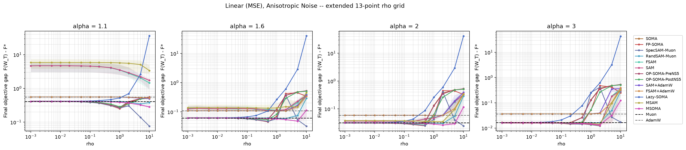

#### 8.1b Isotropic Noise

Median final gap `F − F*` at best stable ρ (0% divergence everywhere; `ridge: 0.01`, 5):

| Optimizer | `alpha=1.1` | `alpha=1.6` | `alpha=2` | `alpha=3` |
|---|---|---|---|---|
| SOMA | 0.6297 | 0.1758 | 0.08596 | 0.04865 |
| FP-SOMA | 0.6536 | 0.1469 | 0.0823 | 0.04125 |
| SpecSAM-Muon | 0.6477 | **0.1406** | **0.07328** | **0.0412** |
| RandSAM-Muon | 1.005 | 0.224 | 0.1082 | 0.05274 |
| FSAM | 6.582 | 0.7527 | 0.2033 | 0.05169 |
| SAM | 6.542 | 0.7355 | 0.2044 | 0.0526 |
| OP-SOMA-PreNS5 | 0.6284 | 0.1765 | 0.08546 | 0.04792 |
| OP-SOMA-PostNS5 | 0.7166 | 0.1617 | 0.08965 | 0.045 |
| SAM+AdamW | 0.3804 | 0.1858 | 0.1354 | 0.09581 |
| FSAM+AdamW | **0.3803** | 0.187 | 0.137 | 0.0973 |
| Lazy-SOMA | 0.9008 | 0.2221 | 0.111 | 0.05521 |
| MSAM | 8.976 | 1.005 | 0.2215 | 0.05525 |
| MSOMA | 0.9906 | 0.2268 | 0.1101 | 0.05257 |
| Muon | 1.015 | 0.2314 | 0.1145 | 0.05516 |
| AdamW | 0.3822 | 0.1904 | 0.1397 | 0.09864 |

**Takeaways:**
- **The heaviest-tail story is noise-structure-dependent, and this is the one place the two noise
  types genuinely disagree on a winner.** Under isotropic noise at `α=1.1`, `SAM+AdamW`/`FSAM+AdamW`
  **win outright** (0.380, beating every Muon-outer method's 0.63–1.02, including plain `Muon`
  itself at 1.015), the opposite of 8.1a's
  anisotropic result where the Muon-outer cluster wins and AdamW-outer sits in between. From `α=1.6`
  onward `SpecSAM-Muon` retakes the lead in both noise settings, so the AdamW-outer advantage is
  specific to the heaviest-tail, isotropic-noise corner of this grid — a genuine, data-grounded
  exception to 8.1a/8.2's "Muon-outer wins the heaviest tail" pattern, not a contradiction to be
  explained away.
- **The SGD-outer blow-up is, if anything, worse here than under anisotropic noise:** `FSAM`/`SAM`/
  `MSAM` reach gaps of 6.5–9.0 at `α=1.1` (vs. 3.5–5.7 anisotropic), while every Muon-outer method
  stays in the same 0.6–1.0 range as its anisotropic counterpart. The outer-optimizer effect from
  8.1a/8.2 holds regardless of noise structure; its *magnitude* under the heaviest tail does not.

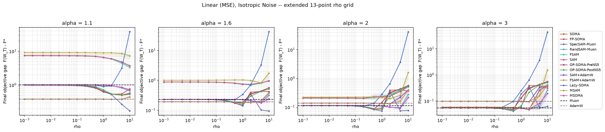

### 8.2 Nonlinear (NN Two-Matrix Classification) Heavy-Tailed Comparison

**What this tests.** The nonlinear counterpart of 8.1: `logits = W_2 · ReLU(W_1 x)` trained
against a same-shaped teacher with cross-entropy (`loss_type: nn_ce`), 512 training + 512 held-out
validation examples, run with `run.measure_alignment: true` so the same sweep also produces the
8.3 cos-θ data below. Configs: `configs/nn_anisotropic_alignment.yaml` / `nn_isotropic_alignment.yaml`
(11 algorithms) plus their `_msam` companions (`MSAM`, `MSOMA`), same output directory, run strictly
sequentially. **0% divergence in every one of the 4,480 (anisotropic) + 4,480 (isotropic) final rows.**

#### 8.2a Anisotropic Noise

Validation accuracy (%) at best stable ρ:

| Optimizer | `alpha=1.1` | `alpha=1.6` | `alpha=2` | `alpha=3` |
|---|---|---|---|---|
| SOMA | 39.06 | 45.02 | 46.29 | 45.41 |
| FP-SOMA | **39.84** | 44.24 | 46.88 | 46.68 |
| SpecSAM-Muon | 37.40 | 43.65 | 46.29 | 46.97 |
| RandSAM-Muon | 37.89 | 42.29 | 44.34 | 44.82 |
| FSAM | 36.43 | 38.48 | 40.23 | 42.87 |
| SAM | 36.33 | 37.99 | 40.04 | 41.80 |
| OP-SOMA-PreNS5 | 38.77 | **45.31** | 46.09 | 46.39 |
| OP-SOMA-PostNS5 | 38.28 | 45.21 | **47.95** | **47.36** |
| SAM+AdamW | 28.91 | 41.60 | 44.14 | 46.00 |
| FSAM+AdamW | 28.71 | 41.70 | 44.34 | 46.29 |
| Lazy-SOMA | 37.89 | 41.31 | 41.41 | 41.80 |
| MSAM | 36.23 | 38.48 | 39.55 | 41.89 |
| MSOMA | 38.28 | 42.97 | 44.63 | 44.43 |
| Muon | 38.09 | 42.87 | 44.04 | 44.34 |
| AdamW | 28.61 | 41.50 | 44.24 | 45.41 |

Training accuracy (%) at the same checkpoints:

| Optimizer | `alpha=1.1` | `alpha=1.6` | `alpha=2` | `alpha=3` |
|---|---|---|---|---|
| SOMA | 56.84 | 74.32 | 78.12 | 80.66 |
| FP-SOMA | 55.08 | 82.03 | 88.18 | 90.82 |
| SpecSAM-Muon | 51.07 | 77.25 | 83.50 | 85.64 |
| RandSAM-Muon | 57.71 | 92.29 | 98.34 | 99.80 |
| FSAM | **92.48** | **99.41** | **100.00** | **100.00** |
| SAM | 92.19 | 99.12 | 100.00 | 100.00 |
| OP-SOMA-PreNS5 | 56.15 | 75.78 | 80.76 | 83.89 |
| OP-SOMA-PostNS5 | 56.84 | 81.15 | 88.57 | 92.29 |
| SAM+AdamW | 36.91 | 61.82 | 71.29 | 77.64 |
| FSAM+AdamW | 36.91 | 62.01 | 71.88 | 75.68 |
| Lazy-SOMA | 57.52 | 71.19 | 74.41 | 77.44 |
| MSAM | 89.75 | 99.12 | 99.90 | 100.00 |
| MSOMA | 58.69 | 92.58 | 98.63 | 100.00 |
| Muon | 57.91 | 92.38 | 98.73 | 99.90 |
| AdamW | 36.91 | 61.82 | 71.78 | 79.49 |

Validation loss at the same checkpoints:

| Optimizer | `alpha=1.1` | `alpha=1.6` | `alpha=2` | `alpha=3` |
|---|---|---|---|---|
| SOMA | 2.387 | 2.090 | 2.051 | 2.080 |
| FP-SOMA | **2.339** | **2.007** | 2.002 | 1.961 |
| SpecSAM-Muon | 2.381 | 2.008 | **1.977** | 1.930 |
| RandSAM-Muon | 2.483 | 2.346 | 2.499 | 2.699 |
| FSAM | 493.555 | 42.161 | 7.339 | 3.793 |
| SAM | 486.518 | 42.460 | 7.499 | 3.827 |
| OP-SOMA-PreNS5 | 2.395 | 2.112 | 2.058 | 2.050 |
| OP-SOMA-PostNS5 | 2.412 | 2.087 | 2.067 | 2.105 |
| SAM+AdamW | 2.924 | 2.075 | 1.983 | 1.933 |
| FSAM+AdamW | 2.927 | 2.075 | 1.980 | **1.924** |
| Lazy-SOMA | 2.487 | 2.168 | 2.161 | 2.246 |
| MSAM | 538.059 | 53.587 | 9.761 | 4.886 |
| MSOMA | 2.474 | 2.359 | 2.521 | 2.741 |
| Muon | 2.486 | 2.357 | 2.514 | 2.756 |
| AdamW | 2.928 | 2.075 | 1.987 | 1.948 |

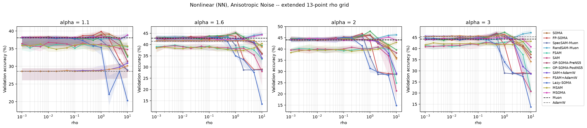
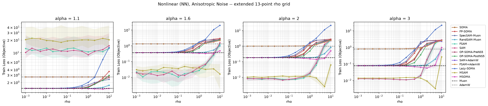

#### 8.2b Isotropic Noise

Validation accuracy (%) at best stable ρ:

| Optimizer | `alpha=1.1` | `alpha=1.6` | `alpha=2` | `alpha=3` |
|---|---|---|---|---|
| SOMA | 38.18 | 44.82 | 46.09 | 45.90 |
| FP-SOMA | 37.79 | 44.24 | 46.58 | 46.09 |
| SpecSAM-Muon | 36.43 | 44.24 | 45.21 | 46.19 |
| RandSAM-Muon | 36.04 | 42.87 | 44.92 | 44.14 |
| FSAM | 35.25 | 38.48 | 39.45 | 42.68 |
| SAM | 35.64 | 38.48 | 39.16 | 41.50 |
| OP-SOMA-PreNS5 | 38.57 | 44.24 | 45.70 | 46.48 |
| OP-SOMA-PostNS5 | 37.89 | **45.21** | **46.78** | **48.34** |
| SAM+AdamW | **40.82** | 43.16 | 44.34 | 45.31 |
| FSAM+AdamW | 40.82 | 43.16 | 44.63 | 46.19 |
| Lazy-SOMA | 36.23 | 41.70 | 41.99 | 39.84 |
| MSAM | 35.35 | 38.18 | 38.67 | 41.41 |
| MSOMA | 36.04 | 42.77 | 44.73 | 43.75 |
| Muon | 36.13 | 43.26 | 45.21 | 43.75 |
| AdamW | 40.62 | 42.97 | 44.14 | 45.80 |

Training accuracy (%) at the same checkpoints:

| Optimizer | `alpha=1.1` | `alpha=1.6` | `alpha=2` | `alpha=3` |
|---|---|---|---|---|
| SOMA | 54.10 | 73.34 | 77.83 | 79.49 |
| FP-SOMA | 53.03 | 81.35 | 87.11 | 89.55 |
| SpecSAM-Muon | 50.00 | 77.54 | 83.30 | 84.77 |
| RandSAM-Muon | 53.81 | 89.16 | 97.66 | 99.61 |
| FSAM | 91.60 | **99.41** | 99.80 | **100.00** |
| SAM | **91.70** | 99.12 | 99.80 | 100.00 |
| OP-SOMA-PreNS5 | 52.64 | 73.93 | 79.79 | 82.32 |
| OP-SOMA-PostNS5 | 53.61 | 78.71 | 86.13 | 91.60 |
| SAM+AdamW | 52.44 | 66.99 | 72.56 | 76.95 |
| FSAM+AdamW | 52.44 | 66.60 | 71.88 | 75.29 |
| Lazy-SOMA | 53.32 | 69.73 | 72.46 | 76.56 |
| MSAM | 89.26 | 99.41 | **100.00** | 100.00 |
| MSOMA | 54.59 | 88.96 | 97.66 | 99.71 |
| Muon | 53.91 | 89.16 | 97.56 | 99.61 |
| AdamW | 52.25 | 67.09 | 73.63 | 78.71 |

Validation loss at the same checkpoints:

| Optimizer | `alpha=1.1` | `alpha=1.6` | `alpha=2` | `alpha=3` |
|---|---|---|---|---|
| SOMA | 2.453 | 2.079 | 2.035 | 2.039 |
| FP-SOMA | 2.396 | 2.019 | 1.968 | 1.952 |
| SpecSAM-Muon | 2.427 | **2.008** | 1.969 | 1.946 |
| RandSAM-Muon | 2.578 | 2.244 | 2.364 | 2.593 |
| FSAM | 537.563 | 44.129 | 6.720 | 3.750 |
| SAM | 535.216 | 44.803 | 6.848 | 3.760 |
| OP-SOMA-PreNS5 | 2.485 | 2.086 | 2.062 | 2.036 |
| OP-SOMA-PostNS5 | 2.494 | 2.075 | 2.071 | 2.109 |
| SAM+AdamW | 2.275 | 2.029 | 1.963 | 1.937 |
| FSAM+AdamW | **2.275** | 2.029 | **1.963** | **1.930** |
| Lazy-SOMA | 2.586 | 2.144 | 2.156 | 2.249 |
| MSAM | 574.351 | 46.042 | 9.197 | 4.836 |
| MSOMA | 2.580 | 2.246 | 2.367 | 2.644 |
| Muon | 2.586 | 2.250 | 2.369 | 2.642 |
| AdamW | 2.276 | 2.029 | 1.967 | 1.944 |

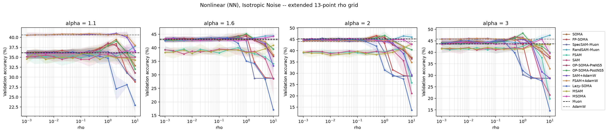
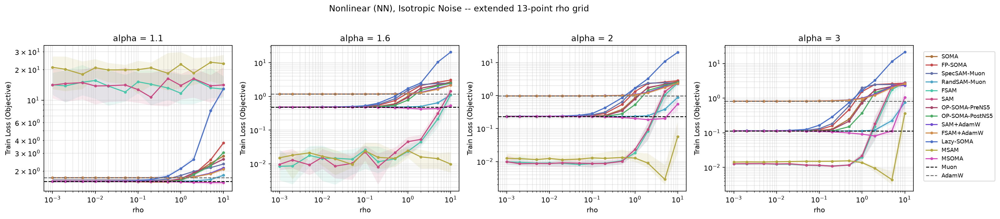

**Takeaways:**
- **The SGD-outer family (`SAM`, `FSAM`, `MSAM`) catastrophically overfits at `α=1.1`, and it is not
  divergence.** All three post 0% divergence yet a validation loss of 486–574 at `α=1.1` (both noise
  types), while training to 89–93% training accuracy. This is the harness's blow-up detector working
  exactly as intended — these runs never produce a non-finite weight — but the resulting classifier
  is confidently, catastrophically wrong on held-out data. Every other algorithm in the table,
  including the Muon-outer twin of the same perturbation (`MSOMA` vs `MSAM`), lands at a val loss
  around 2.4–2.6 at the same `α`. **It is the outer optimizer, not the perturbation source, that
  determines robustness here** — `MSAM`→`MSOMA` is a pure outer-optimizer swap (6) and it alone
  closes a 500+ point val-loss gap.
- **AdamW-outer SAM variants avoid that collapse without Muon's spectral geometry.** `SAM+AdamW` /
  `FSAM+AdamW` post val loss 2.27–2.93 at `α=1.1` — far below the SGD-outer family's 486–574, even
  though both are still Frobenius-geometry SAM. AdamW's per-parameter adaptive scaling is evidently
  enough on its own to prevent the worst heavy-tailed blow-up, independent of Muon's spectral
  normalization — but it does not match Muon-outer validation *accuracy* at the heaviest tail
  (28–29% anisotropic vs 36–39% for the Muon family), so AdamW buys stability, not the accuracy edge.
- **Among Muon-outer methods, the friendly/stale-spectral family (`SOMA`, `FP-SOMA`, `OP-SOMA-*`,
  `SpecSAM-Muon`) clusters tightly at the top of validation accuracy across every `α`**, with
  `OP-SOMA-PostNS5` winning outright at `α=2.0`/anisotropic (47.95%) and `α=3.0`/isotropic (48.34%).
  `Lazy-SOMA` (the cheapest, single-pass, no-spectral-refresh method) and `RandSAM-Muon`/`MSOMA`
  (no gradient information in the perturbation at all) trail this cluster by 2–6 accuracy points at
  every `α`, a small but consistent cost for the cheaper or information-free perturbation.
- **Noise structure (isotropic vs. anisotropic) moves validation accuracy by at most ~2 points for
  every algorithm at every `α`** — far smaller than the 5–10 point swings driven by `α` itself. This
  mirrors the cos-θ finding in 8.3 below: tail-heaviness, not the noise's directional structure, is
  what mainly governs behavior in this testbed.

### 8.3 Perturbation Alignment: cos(θ) Between the SAM Perturbation and the Gradient / Momentum

> 📌 **Direct Table Links:**
> - [Jump to: cos(ε, gradient after perturbing) table](#table-cos-pert-grad)
> - [Jump to: cos(ε, momentum after this step's outer update) table](#table-cos-pert-momentum)

**What this measures and why.** A SAM-type step perturbs the weights by some direction `ε_t`, then
takes a gradient `g̃_t = ∇F(w_t + ε_t)` at the perturbed point — the gradient actually used for
that step's outer update. This measures how aligned `ε_t` is with (a) that **post-perturbation**
gradient `g̃_t` and (b) the optimizer's **post-update** momentum buffer (i.e. once the outer step
has refreshed it using `g̃_t`). `cos(θ) = 1` means `ε_t` points exactly along that reference vector
(`θ=0°`); `cos(θ) = -1` means exactly opposite (`θ=180°`); `cos(θ) ≈ 0` means uncorrelated (`θ≈90°`).

Deliberately **not** measured: `ε_t` against the *pre*-perturbation gradient/momentum that may have
built it. For every grad- or friendly-sourced algorithm with Frobenius geometry (a pure rescaling),
`ε_t` is parallel to that source vector by construction, so comparing against it would read a
trivial ≈1 and say nothing about the SAM mechanism; same story for `MSAM`/`MSOMA`'s momentum
lookahead (≈-1 trivially). Comparing against the *post*-perturbation quantities instead asks a real
question for every one of the 13 algorithms: **does the ascent step rotate the gradient/momentum
direction, and by how much?** — a sharpness/curvature probe along `ε_t`, not a restatement of how
`ε_t` was built.

**Implementation.** An opt-in `run.measure_alignment` flag (default off) threads through
`Engine.step()`: `total_cosine(ε_t, g̃_t)` (a multi-layer cosine over the concatenated Frobenius
inner product, `linalg.py`) is recorded right after `g̃_t` is computed, and
`total_cosine(ε_t, state.momentum)` right after the outer step updates that buffer using `g̃_t` —
NaN wherever either vector has zero norm (e.g. `cos_pert_momentum` for `SAM+AdamW`/`FSAM+AdamW`,
whose AdamW outer never touches `state.momentum` at all, or for `SAM`/`FSAM`'s zero-momentum SGD).
This costs **no extra oracle call**: both `g̃_t` and the updated momentum are already computed for
the main algorithm regardless of this flag, just not previously compared against `ε_t`. 8.2's
alignment sweeps turn this on for all 13 curated algorithms.

Per algorithm/α/ρ, the CSVs below report the across-seed central tendency and IQR of the per-seed
final-step cosine (8 seeds; for an algorithm with both `frobenius_modes`, only the `global` mode is
used, never pooled with `per-layer` — pooling the two would silently double the effective seed
count), plus `theta_degrees = arccos(center cos θ)` for a more intuitive angle reading.

- `results/heavytailed_figures_preview/cos_pert_grad_by_rho.csv` /
  `cos_pert_grad_by_rho_isotropic.csv` — perturbation vs. gradient.
- `results/heavytailed_figures_preview/cos_pert_momentum_by_rho.csv` /
  `cos_pert_momentum_by_rho_isotropic.csv` — perturbation vs. momentum.

**Central-tendency statistic.** The default (and every plot embedded below) uses the **median**,
matching every other table in this README. `synthetic_ablations/cos_theta_stats.py` (the generator
for every cos-θ CSV/plot in this section) takes `--stat {median,mean,mode}`; `mean` is the ordinary
average, and `mode` is the **half-sample mode** (Bickel & Frühwirth 2006) — with only 8 seeds, a
density/KDE mode would be bandwidth-dependent and arbitrary, whereas the half-sample mode is
deterministic and needs no tuning parameter (recursively keep whichever half of the sorted sample
is most tightly clustered until 1–2 points remain). Running

```
python synthetic_ablations/cos_theta_stats.py <finals.csv> results/heavytailed_figures_preview \
  --stat mean --noise-label anisotropic   # or: --stat mode / --noise-label isotropic
```

writes the same six file types again under an explicit `_mean`/`_mode` suffix (e.g.
`cos_pert_grad_by_rho_mean.csv`, `vector_angle_grad_mode_isotropic.png`) rather than overwriting the
median files — all three statistics are published side by side in
`results/heavytailed_figures_preview/`, not just median.

<!-- cos(perturbation, X) vs rho line plots: commented out (hard to read as literal angles,
e.g. a flat line at `cos θ=0.3` doesn't intuitively read as "72°"); the vector-angle polar diagrams
below are the kept replacement. CSVs (`cos_pert_grad_by_rho*.csv` / `cos_pert_momentum_by_rho*.csv`)
still contain this same data if the line-plot view is ever wanted again.


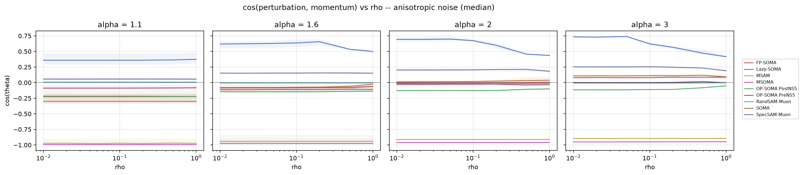
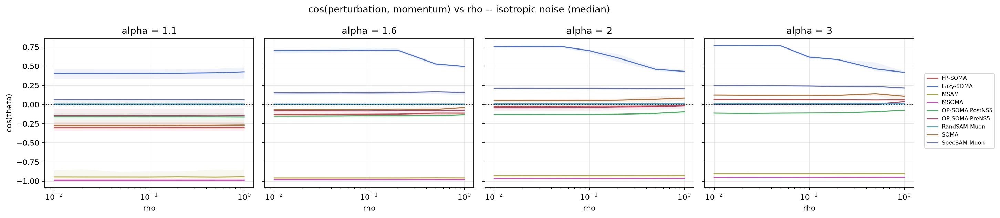
-->

The same cos(θ) data is rendered as a polar compass diagram at a fixed ρ=0.2: a bold black
reference arrow at 0° (the gradient or momentum direction), one colored arrow per algorithm at
`θ=arccos(median cos θ)`, and a shaded wedge spanning the IQR.


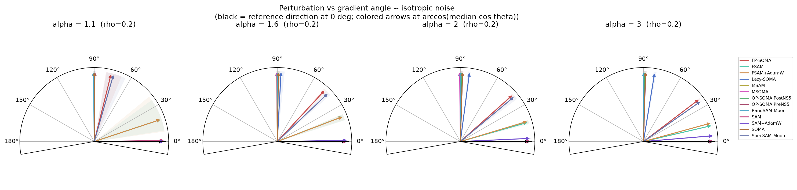
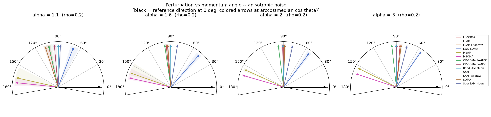
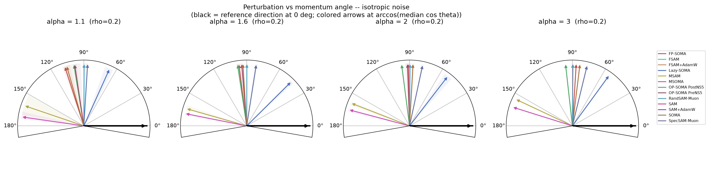

#### Mean and Mode Variants

The same six file types above, regenerated with `--stat mean` and `--stat mode` ("Central-tendency
statistic" above) rather than the default median — not overwritten, published side by side.

<!-- cos(perturbation, X) vs rho line plots (mean): commented out, see note above.
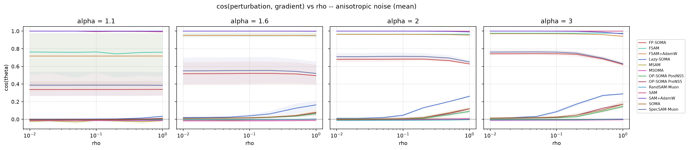


-->
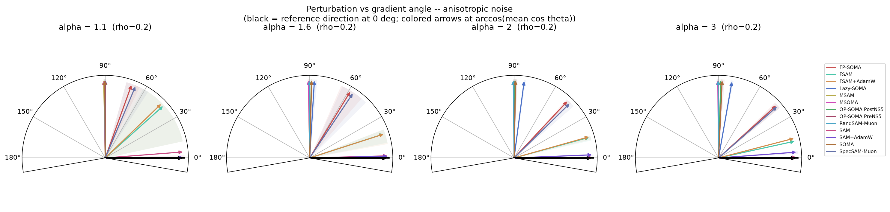
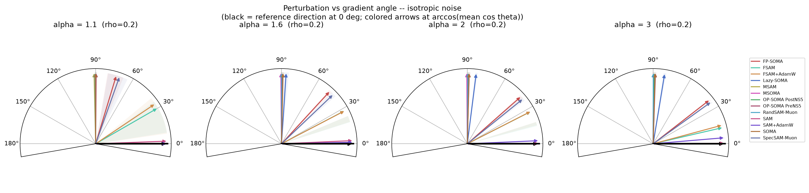


<!-- cos(perturbation, X) vs rho line plots (mode): commented out, see note above.

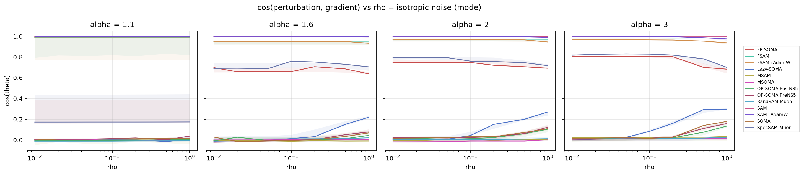

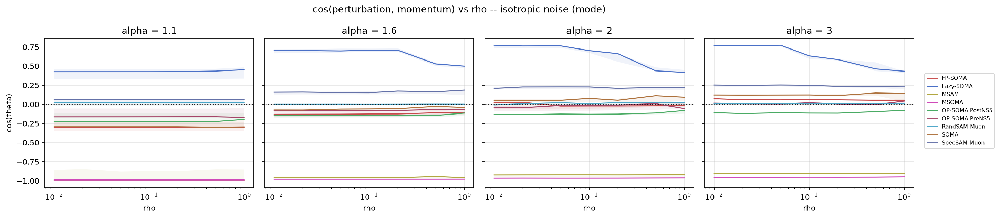
-->
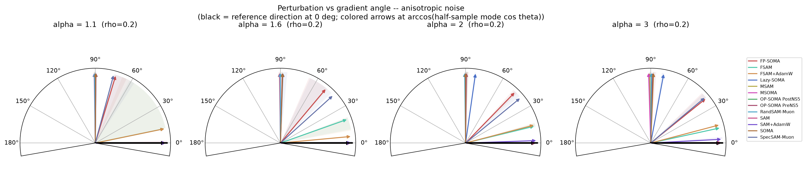

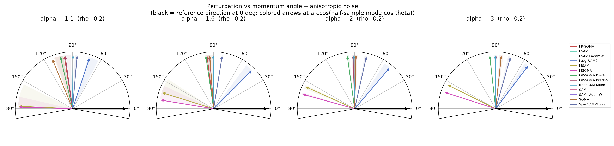


#### Summary: cos(θ) by Statistic, Across All α, at Each Algorithm's Own Best Stable ρ (Anisotropic)

The vector-angle diagrams and the single-ρ=0.2 discussion above hold ρ fixed across algorithms for
a clean apples-to-apples comparison at equal perturbation radius. The table below instead evaluates
each algorithm at **its own best stable ρ per α** — the same ρ actually used for 8.2's headline
val-acc/loss numbers — so these cos(θ) values describe the perturbation each algorithm is actually
run with, not an arbitrary shared radius. Numbers therefore differ somewhat from the ρ=0.2 snapshot
above; both views are valid, they just answer different questions (sensitivity to a common ρ, vs.
behavior at the ρ each algorithm is deployed at). Where mean and mode disagree noticeably (e.g.
`FSAM`, `FSAM+AdamW`), mean is the one being pulled around by a small number of outlier seeds —
exactly the kind of outlier this whole codebase studies — so median/mode agreeing with each other
more than either agrees with mean is itself informative, not a discrepancy to explain away.

**Quick Table Navigation:** [Jump to Gradient Alignment Table](#table-cos-pert-grad) · [Jump to Momentum Alignment Table](#table-cos-pert-momentum)

<a id="table-cos-pert-grad"></a>
<a id="cos-pert-grad"></a>
##### Table: cos(ε, gradient after perturbing)
*(each cell is `cos θ (θ°)`)*

| Optimizer | What it stands for | Median α=1.1 | Median α=1.6 | Median α=2 | Median α=3 | Mean α=1.1 | Mean α=1.6 | Mean α=2 | Mean α=3 | Mode α=1.1 | Mode α=1.6 | Mode α=2 | Mode α=3 |
|---|---|---|---|---|---|---|---|---|---|---|---|---|---|
| **SOMA** | Stale Momentum-friendly, Spectral SAM-Muon | 0.0081 (89.54°) | 0.0714 (85.90°) | 0.1190 (83.16°) | 0.1722 (80.08°) | 0.0048 (89.73°) | 0.0794 (85.44°) | 0.1202 (83.10°) | 0.1695 (80.24°) | 0.0147 (89.16°) | 0.0601 (86.55°) | 0.1316 (82.44°) | 0.2118 (77.77°) |
| **FP-SOMA** | Fresh-Probe friendly, spectral SAM-Muon | 0.3110 (71.88°) | 0.5937 (53.58°) | 0.6780 (47.31°) | 0.6782 (47.30°) | 0.3386 (70.21°) | 0.5139 (59.08°) | 0.6650 (48.32°) | 0.6843 (46.82°) | 0.2893 (73.18°) | 0.6281 (51.09°) | 0.6780 (47.31°) | 0.6782 (47.30°) |
| **SpecSAM-Muon** | Plain spectral SAM-Muon (fresh grad) | 0.3431 (69.94°) | 0.6309 (50.89°) | 0.7089 (44.86°) | 0.6933 (46.11°) | 0.3853 (67.34°) | 0.5432 (57.09°) | 0.6946 (46.01°) | 0.6929 (46.14°) | 0.2598 (74.94°) | 0.6677 (48.11°) | 0.7371 (42.51°) | 0.7019 (45.42°) |
| **RandSAM-Muon** | Random-direction SAM-Muon | -0.0108 (90.62°) | 0.0002 (89.99°) | -0.0042 (90.24°) | 0.0006 (89.97°) | -0.0062 (90.35°) | 0.0028 (89.84°) | -0.0042 (90.24°) | 0.0019 (89.89°) | -0.0124 (90.71°) | -0.0055 (90.31°) | -0.0061 (90.35°) | -0.0109 (90.63°) |
| **FSAM** | Friendly SAM, SGD outer | 0.8950 (26.49°) | 0.9518 (17.86°) | 0.9708 (13.89°) | 0.9755 (12.72°) | 0.7607 (40.47°) | 0.9493 (18.32°) | 0.9638 (15.47°) | 0.9760 (12.57°) | 0.9788 (11.83°) | 0.9958 (5.25°) | 0.9708 (13.89°) | 0.9748 (12.90°) |
| **SAM** | Plain SAM, SGD outer | 0.9994 (2.02°) | 1.0000 (0.57°) | 0.9997 (1.40°) | 0.9994 (2.04°) | 0.9918 (7.35°) | 0.9996 (1.53°) | 0.9985 (3.17°) | 0.9992 (2.26°) | 1.0000 (0.12°) | 1.0000 (0.07°) | 0.9997 (1.40°) | 0.9994 (2.04°) |
| **OP-SOMA PreNS5** | Orthogonally-Projected SOMA (pre-NS5) | 0.0195 (88.88°) | 0.0906 (84.80°) | 0.1295 (82.56°) | 0.1653 (80.49°) | 0.0106 (89.39°) | 0.0743 (85.74°) | 0.1186 (83.19°) | 0.1709 (80.16°) | 0.0228 (88.69°) | 0.1011 (84.20°) | 0.1317 (82.43°) | 0.1366 (82.15°) |
| **OP-SOMA PostNS5** | Orthogonally-Projected SOMA (post-NS5) | 0.0052 (89.70°) | 0.0591 (86.61°) | 0.0937 (84.62°) | 0.1543 (81.12°) | 0.0036 (89.79°) | 0.0640 (86.33°) | 0.0885 (84.92°) | 0.1446 (81.69°) | 0.0052 (89.70°) | 0.0282 (88.38°) | 0.0937 (84.62°) | 0.1549 (81.09°) |
| **SAM+AdamW** | Plain SAM, AdamW outer | 1.0000 (0.34°) | 1.0000 (0.13°) | 0.9971 (4.35°) | 0.9893 (8.40°) | 0.9999 (0.79°) | 1.0000 (0.16°) | 0.9967 (4.65°) | 0.9876 (9.04°) | 1.0000 (0.08°) | 1.0000 (0.01°) | 0.9985 (3.15°) | 0.9931 (6.75°) |
| **FSAM+AdamW** | Friendly SAM, AdamW outer | 0.8351 (33.38°) | 0.9500 (18.20°) | 0.9649 (15.23°) | 0.9435 (19.35°) | 0.7173 (44.17°) | 0.9514 (17.94°) | 0.9598 (16.29°) | 0.9416 (19.68°) | 0.9791 (11.74°) | 0.9957 (5.34°) | 0.9639 (15.45°) | 0.9491 (18.37°) |
| **Lazy-SOMA** | Lazy spectral SAM-Muon (reuses last update) | 0.0061 (89.65°) | 0.1432 (81.77°) | 0.1994 (78.50°) | 0.2670 (74.51°) | 0.0018 (89.89°) | 0.1263 (82.74°) | 0.2017 (78.37°) | 0.2702 (74.33°) | 0.0072 (89.59°) | 0.1820 (79.51°) | 0.1975 (78.61°) | 0.2670 (74.51°) |
| **MSAM** | Momentum-SAM (Becker et al. 2024), SGD outer | -0.0200 (91.15°) | -0.0095 (90.54°) | 0.0077 (89.56°) | -0.0028 (90.16°) | -0.0271 (91.55°) | -0.0156 (90.89°) | 0.0048 (89.72°) | 0.0004 (89.97°) | -0.0152 (90.87°) | -0.0133 (90.76°) | 0.0077 (89.56°) | 0.0062 (89.64°) |
| **MSOMA** | Momentum-SAM, Muon outer | -0.0148 (90.85°) | -0.0108 (90.62°) | -0.0014 (90.08°) | -0.0201 (91.15°) | -0.0132 (90.76°) | -0.0158 (90.90°) | -0.0027 (90.16°) | -0.0111 (90.63°) | -0.0148 (90.85°) | -0.0108 (90.62°) | -0.0175 (91.01°) | -0.0234 (91.34°) |

**Why (cos(ε, gradient after perturbing)):**

| Optimizer | Why |
|---|---|
| **SOMA** | Its perturbation is deliberately reshaped so it no longer points like a gradient — so it has little in common with the new gradient either. |
| **FP-SOMA** | Same reshaping as SOMA; using today's gradient instead of an old one only partly recovers the correlation. |
| **SpecSAM-Muon** | Even a fresh gradient gets reshaped by this geometry, so it stops looking like a plain gradient — the reshaping is the cause, not staleness. |
| **RandSAM-Muon** | It's pure random noise — it was never going to match any gradient, before or after. |
| **FSAM** | It's the gradient with a momentum-like piece subtracted out, so it still mostly points like a gradient; noisier gradients at heavy tails rotate it further off. |
| **SAM** | It *is* the gradient, just rescaled, and one small step barely changes the gradient's direction — so the two line up almost exactly. |
| **OP-SOMA PreNS5** | Built on purpose to cancel out the gradient-like part of its direction, so it ends up unrelated to the gradient by design. |
| **OP-SOMA PostNS5** | Same cancellation idea as PreNS5, just applied in a different order. |
| **SAM+AdamW** | Same as `SAM` — AdamW only changes how big the step is, not which way it points. |
| **FSAM+AdamW** | Same as `FSAM` — AdamW doesn't change the direction logic, only the step size. |
| **Lazy-SOMA** | It just reuses an old, already-reshaped update, so it inherits the same "doesn't look like a gradient" property. |
| **MSAM** | It's built purely from momentum, with no gradient information in it, so there's no reason it should match the new gradient. |
| **MSOMA** | Same as `MSAM` — swapping in a Muon outer doesn't change what the perturbation is built from. |

<a id="table-cos-pert-momentum"></a>
<a id="cos-pert-momentum"></a>
##### Table: cos(ε, momentum after this step's outer update)
*(each cell is `cos θ (θ°)`)*

| Optimizer | What it stands for | Median α=1.1 | Median α=1.6 | Median α=2 | Median α=3 | Mean α=1.1 | Mean α=1.6 | Mean α=2 | Mean α=3 | Mode α=1.1 | Mode α=1.6 | Mode α=2 | Mode α=3 |
|---|---|---|---|---|---|---|---|---|---|---|---|---|---|
| **SOMA** | Stale Momentum-friendly, Spectral SAM-Muon | -0.2995 (107.43°) | -0.0257 (91.47°) | 0.0390 (87.77°) | 0.0925 (84.69°) | -0.2671 (105.49°) | -0.0320 (91.83°) | 0.0502 (87.12°) | 0.1001 (84.26°) | -0.3154 (108.38°) | 0.0170 (89.03°) | 0.0232 (88.67°) | 0.0648 (86.28°) |
| **FP-SOMA** | Fresh-Probe friendly, spectral SAM-Muon | -0.2237 (102.93°) | -0.1055 (96.06°) | -0.0001 (90.01°) | 0.0865 (85.04°) | -0.2431 (104.07°) | -0.0917 (95.26°) | -0.0053 (90.30°) | 0.0829 (85.24°) | -0.1540 (98.86°) | -0.0907 (95.20°) | 0.0307 (88.24°) | 0.0896 (84.86°) |
| **SpecSAM-Muon** | Plain spectral SAM-Muon (fresh grad) | 0.0564 (86.77°) | 0.1544 (81.12°) | 0.2135 (77.67°) | 0.2334 (76.50°) | 0.0589 (86.63°) | 0.1619 (80.68°) | 0.2011 (78.40°) | 0.2305 (76.67°) | 0.0837 (85.20°) | 0.1487 (81.45°) | 0.2135 (77.67°) | 0.2350 (76.41°) |
| **RandSAM-Muon** | Random-direction SAM-Muon | 0.0084 (89.52°) | -0.0039 (90.23°) | -0.0127 (90.73°) | -0.0017 (90.10°) | 0.0028 (89.84°) | -0.0012 (90.07°) | -0.0103 (90.59°) | -0.0066 (90.38°) | 0.0084 (89.52°) | -0.0074 (90.42°) | -0.0127 (90.73°) | 0.0025 (89.86°) |
| **FSAM** | Friendly SAM, SGD outer | N/A | N/A | N/A | N/A | N/A | N/A | N/A | N/A | N/A | N/A | N/A | N/A |
| **SAM** | Plain SAM, SGD outer | N/A | N/A | N/A | N/A | N/A | N/A | N/A | N/A | N/A | N/A | N/A | N/A |
| **OP-SOMA PreNS5** | Orthogonally-Projected SOMA (pre-NS5) | -0.0824 (94.73°) | -0.0618 (93.54°) | -0.0325 (91.86°) | -0.0037 (90.21°) | -0.0777 (94.46°) | -0.0606 (93.47°) | -0.0131 (90.75°) | 0.0054 (89.69°) | -0.1224 (97.03°) | -0.0691 (93.96°) | -0.0421 (92.41°) | -0.0050 (90.28°) |
| **OP-SOMA PostNS5** | Orthogonally-Projected SOMA (post-NS5) | -0.2220 (102.83°) | -0.1367 (97.86°) | -0.1003 (95.76°) | -0.0514 (92.95°) | -0.1865 (100.75°) | -0.1200 (96.89°) | -0.1045 (96.00°) | -0.0535 (93.07°) | -0.2220 (102.83°) | -0.1403 (98.07°) | -0.0802 (94.60°) | -0.0514 (92.95°) |
| **SAM+AdamW** | Plain SAM, AdamW outer | N/A | N/A | N/A | N/A | N/A | N/A | N/A | N/A | N/A | N/A | N/A | N/A |
| **FSAM+AdamW** | Friendly SAM, AdamW outer | N/A | N/A | N/A | N/A | N/A | N/A | N/A | N/A | N/A | N/A | N/A | N/A |
| **Lazy-SOMA** | Lazy spectral SAM-Muon (reuses last update) | 0.3596 (68.93°) | 0.5348 (57.67°) | 0.4557 (62.89°) | 0.4719 (61.84°) | 0.3812 (67.59°) | 0.5234 (58.44°) | 0.4600 (62.62°) | 0.4874 (60.83°) | 0.3153 (71.62°) | 0.5442 (57.03°) | 0.4536 (63.02°) | 0.4388 (63.97°) |
| **MSAM** | Momentum-SAM (Becker et al. 2024), SGD outer | -0.9692 (165.73°) | -0.9428 (160.52°) | -0.9109 (155.62°) | -0.8937 (153.34°) | -0.9178 (156.61°) | -0.8463 (147.81°) | -0.9128 (155.89°) | -0.8915 (153.07°) | -0.9985 (176.88°) | -0.9537 (162.51°) | -0.9109 (155.62°) | -0.8933 (153.30°) |
| **MSOMA** | Momentum-SAM, Muon outer | -0.9942 (173.85°) | -0.9763 (167.50°) | -0.9610 (163.95°) | -0.9505 (161.90°) | -0.9596 (163.65°) | -0.8986 (153.97°) | -0.9597 (163.69°) | -0.9482 (161.49°) | -0.9995 (178.27°) | -0.9866 (170.60°) | -0.9626 (164.27°) | -0.9515 (162.09°) |

**Why (cos(ε, momentum after this step's outer update)):**

| Optimizer | Why |
|---|---|
| **SOMA** | It's built to subtract out a momentum-like piece, so it ends up pointing mildly *against* the momentum that results. |
| **FP-SOMA** | Same subtraction idea as SOMA, just using a fresh probe instead of an old one. |
| **SpecSAM-Muon** | It isn't built from momentum at all, so only a weak, mostly-incidental relationship with momentum remains. |
| **RandSAM-Muon** | Pure randomness — no relationship with momentum either. |
| **FSAM** | This setup keeps no momentum at all, so there's nothing to compare ε against. |
| **SAM** | Same as `FSAM` — no momentum buffer exists here either. |
| **OP-SOMA PreNS5** | Built on purpose to be perpendicular to momentum — that's the whole design goal. |
| **OP-SOMA PostNS5** | Same subtraction idea as SOMA, so the same mild push-against-momentum shows up here too. |
| **SAM+AdamW** | AdamW tracks its own separate statistics instead of this momentum buffer, so there's nothing to compare. |
| **FSAM+AdamW** | Same as `SAM+AdamW` — AdamW keeps its own buffers, not this one. |
| **Lazy-SOMA** | It reuses the previous momentum-based update directly (no subtraction), so it naturally keeps pointing the way momentum is already heading. |
| **MSAM** | It's literally built as "the opposite of old momentum," and momentum doesn't change direction quickly — so it stays close to opposite the new momentum too. |
| **MSOMA** | Same idea as `MSAM` — a different outer optimizer doesn't change this relationship. |

**Takeaways:**
- **`RandSAM-Muon` is the cleanest sanity check, and it still passes without being tautological.**
  Its perturbation is an independent Gaussian direction, so the gradient computed at that randomly
  perturbed point has no reason to correlate with it either — and indeed `cos(ε, g̃) ≈ 0` (±0.01,
  `θ≈90°`) at every α/ρ/noise setting. Unlike the pre-perturbation comparison this section used to
  report, this is no longer guaranteed by construction; it's an empirical confirmation that the
  measurement behaves as it should.
- **`SAM`/`SAM+AdamW` induce very little gradient rotation over one ascent step at this
  (late-training, annealed-lr) snapshot: `cos(ε, g̃) = 0.998–1.000` across every α.** This is a real
  finding, not the trivial identity the pre-perturbation comparison gave — it says the loss surface
  is locally close to flat along the ascent direction by the end of training in this testbed, for
  plain gradient-sourced SAM specifically. `FSAM`/`FSAM+AdamW` (the *friendly*, bias-corrected
  variant of the same SGD/AdamW-outer family) rotate the gradient much more at the heaviest tail
  (`cos(ε, g̃) = 0.828` / `0.835` at `α=1.1`, rising to `0.976` / `0.966` at `α=3.0`) — subtracting a
  momentum-like term from the probe direction measurably changes how much curvature the ascent step
  exposes, especially under heavy tails.
- **`MSAM`/`MSOMA` stay strongly (not perfectly) anti-aligned with their own post-update momentum,
  and the anti-alignment *weakens* as the tail lightens:** `MSAM`'s `cos(ε, v)` goes from `-0.975` at
  `α=1.1` to `-0.895` at `α=3.0`; `MSOMA` from `-0.994` to `-0.949`. The lookahead perturbation
  (built from *last* step's momentum) tracks the *updated* momentum less perfectly once gradients
  stop being dominated by rare extreme values — a real, continuous relationship the old
  by-construction `≈-1.000` could never have shown.
- **Two algorithms flip sign across α for `cos(ε, v)`: `SOMA` (`-0.300` at `α=1.1` → `+0.111` at
  `α=3.0`) and `FP-SOMA` (`-0.224` → `+0.087`).** Their stale/fresh-friendly perturbation opposes the
  resulting momentum under the heaviest tail but mildly reinforces it once the tail lightens — a
  qualitative regime change, not just a magnitude change. `Lazy-SOMA` is the one clear outlier in
  the other direction, staying *positively* aligned with post-update momentum throughout
  (`+0.36` to `+0.74` depending on α and ρ) — its raw, unprocessed previous-update perturbation
  tracks the momentum trajectory far more than any other algorithm's.
- **`SpecSAM-Muon` and `FP-SOMA` still show the largest α-driven swing in `cos(ε, g̃)`** (≈0.34→0.76
  and ≈0.31→0.75 respectively, anisotropic), the same qualitative pattern as before this section's
  metric correction: under the heaviest tails, the gradient at the perturbed point has little in
  common with the direction that built ε; as the tail lightens, that rotation shrinks.
- **Does noise *structure* (isotropic vs. anisotropic), not just tail-heaviness, affect cos(θ)? Still
  mostly no, with the same two exceptions as before the correction.** Holding ρ=0.2 fixed, most
  algorithms differ by under 0.03 between noise settings — far smaller than their own α-driven
  swings. `FSAM` and `FSAM+AdamW` remain the exception: `cos(ε, g̃)` differs by 0.11–0.12 between
  noise types at `α=1.1` specifically (`FSAM`: 0.828 anisotropic vs. 0.949 isotropic), comparable to
  their own α-driven range (0.13–0.15), not 5–10× smaller. `SpecSAM-Muon`/`FP-SOMA` sit in between
  (≈0.04–0.08 at every α, smaller than FSAM's gap but not negligible either). **Conclusion unchanged
  by the metric correction: tail-heaviness (α) remains the dominant driver of cos(θ) for most of the
  curated set, with `FSAM`/`FSAM+AdamW` a consistent, genuine counterexample** — reassuring, since it
  means this specific qualitative finding was not an artifact of the bug being fixed here.
